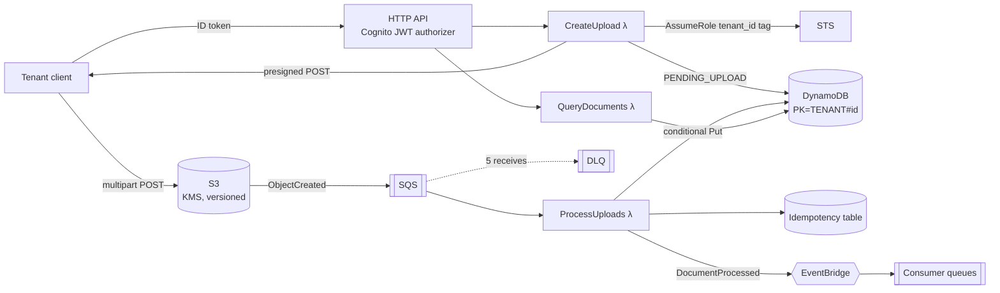

# serverless-doc-pipeline

Multi-tenant document ingestion on AWS SAM: tenants upload files straight to S3 with **presigned POSTs scoped to their own prefix**, and an **S3 → SQS → Lambda** pipeline validates, checksums and extracts metadata (CSV shape, JSON structure, PDF page count). It does this **exactly once in effect**, whatever S3 and SQS redeliver, and announces `DocumentProcessed` on EventBridge.

Plain TypeScript Lambda handlers in a hexagonal layout (no framework, see [ADR 0002](docs/adr/0002-lambda-over-fargate.md)), AWS Lambda Powertools for idempotency, batch processing, logging, tracing and EMF metrics.

## Why this exists

| Problem | How it is handled | Where |
|---|---|---|
| Files must not flow through Lambda (6 MB payload limit, cost) | Presigned **POST** with exact key, `content-length-range` and pinned `Content-Type`; browser uploads straight to S3 | [s3-upload-signer.ts](src/adapters/s3-upload-signer.ts) |
| One tenant reading or overwriting another's data | Tenant from the Cognito claim only; `PK = TENANT#id`; API calls signed with **tenant-tagged STS sessions** restricted by `dynamodb:LeadingKeys` and an S3 prefix condition | [ADR 0005](docs/adr/0005-tenant-isolation.md), [tenant-session.ts](src/adapters/tenant-session.ts) |
| Upload bursts, at-least-once S3 events | S3 → **SQS** → Lambda with reserved concurrency and ESM max concurrency | [ADR 0003](docs/adr/0003-sqs-between-s3-and-lambda.md) |
| One bad file blocking its batch | `ReportBatchItemFailures` via Powertools `BatchProcessor`; DLQ after 5 receives; redrive runbook | [process-uploads.ts](src/handlers/process-uploads.ts), [runbook](docs/runbook.md) |
| Duplicate deliveries (sequential and concurrent) | **Powertools idempotency** on `(bucket, key, sequencer)` in DynamoDB + **conditional status transition** + S3 **version pinning** | [ADR 0004](docs/adr/0004-idempotency.md) |
| Invalid files vs. transient failures | Invalid content → `REJECTED` (never retried); unknown errors → retry → DLQ | [ADR 0006](docs/adr/0006-reject-vs-retry.md) |
| Spoofed content types, oversize files | Magic-byte/UTF-8 sniffing, size re-checked without buffering | [inspect-content.ts](src/application/inspect-content.ts) |
| Downstream work (indexing, billing) | `DocumentProcessed` on a custom EventBridge bus → per-consumer SQS queue + DLQ, 30-day archive for replay | [events.ts](src/application/events.ts), [template.yaml](template.yaml) |
| Operability | JSON logs with correlation ids, X-Ray, EMF metrics, 10 alarms, dashboard | [observability.ts](src/infra/observability.ts), [runbook](docs/runbook.md) |
| Cold starts | Per-handler esbuild bundles, arm64, provisioned concurrency only on the upload API in prod | [ADR 0007](docs/adr/0007-cold-starts-and-bundling.md) |

## Architecture



Containers, sequence diagram and data model: [docs/architecture.md](docs/architecture.md).

## Run locally

Requirements: Node 22, Docker. Uses host ports 4569 (LocalStack) and 3300 (local API) only.

```bash
npm ci
docker compose up -d --wait     # LocalStack 3.8: S3, SQS, DynamoDB, EventBridge, STS
npm run local                   # creates resources, serves http://localhost:3300, polls SQS
```

`npm run local` runs the real handlers behind a tiny stand-in for API Gateway and the SQS event source mapping ([scripts/local-api.ts](scripts/local-api.ts)). There is no Cognito locally: `Authorization: Bearer <tenant-id>` becomes the `custom:tenant_id` claim.

```bash
# 1. ask for an upload form
curl -s -X POST localhost:3300/documents -H 'Authorization: Bearer acme' \
  -H 'content-type: application/json' \
  -d '{"fileName":"sample.csv","contentType":"text/csv","sizeBytes":20}'
# 2. POST the file to upload.url with every upload.fields entry as a form field, file last
# 3. check the status
curl -s localhost:3300/documents/<documentId> -H 'Authorization: Bearer acme'
```

Verified on 2026-08-25 with that flow: `204` from LocalStack S3, then `PROCESSED` with `sha256` and `{"kind":"csv","rowCount":2,"columnCount":2}`; the same id with `Bearer globex` returned `404`.

## API

All routes require a Cognito **ID token** (it carries `custom:tenant_id`). Errors are [RFC 9457](https://www.rfc-editor.org/rfc/rfc9457) problem details with the API Gateway `requestId`.

| Method | Path | Body / query | Response |
|---|---|---|---|
| `POST` | `/documents` | `{fileName, contentType: application/pdf\|text/csv\|application/json, sizeBytes}` | `201 {documentId, upload: {url, fields}, expiresAt, maxBytes}` |
| `GET` | `/documents/{documentId}` | – | `200` status, size, `sha256`, `metadata`, `rejectionReason`; `404` for unknown **or other tenants'** ids |
| `GET` | `/documents` | `limit` (1-100), `cursor` | `200 {items, nextCursor}` newest first |

Events on the `<stack>-documents` bus (`source: doc-pipeline.documents`): `DocumentProcessed`, `DocumentRejected`, both with `detail.eventId` for de-duplication. Contract: [src/application/events.ts](src/application/events.ts).

## Tests

```bash
npm test          # 108 unit tests: domain, use cases, adapters and handlers (aws-sdk-client-mock)
npm run test:int  # 8 integration tests against LocalStack (Testcontainers, random port)
npm run typecheck && npm run lint
```

Integration tests run the real handlers against LocalStack S3, SQS, DynamoDB and EventBridge and cover:

- upload through the presigned POST → S3 notification → processor → `PROCESSED` via the status API, plus `DocumentProcessed` captured from the bus;
- PDF page counting; cross-tenant `404`;
- **duplicate delivery**: the same S3 event delivered again sequentially and concurrently → one record transition, one event; with the idempotency record deleted, the conditional transition still holds and the event is re-published with the same `eventId`;
- **poison file → DLQ**: a corrupt PDF fails only its own message in a mixed batch, is redriven to the DLQ by SQS after `maxReceiveCount`, and the document stays `PENDING_UPLOAD`;
- content-type spoofing → `REJECTED` + object tagged for expiry; oversized object → `REJECTED` by the processor.

Not covered by integration tests (LocalStack Community does not enforce them): IAM policies (tenant `LeadingKeys`, prefix conditions) and the presigned POST `content-length-range` — the latter is asserted on the signed policy in unit tests.

## Deploy

```bash
sam build && sam deploy --guided            # dev
sam deploy --config-env prod                # prod profile in samconfig.toml
```

The template is validated with `cfn-lint` (locally: cfn-lint 1.29, clean) and `sam validate --lint` in CI. CI ([.github/workflows/ci.yml](.github/workflows/ci.yml)) runs typecheck, lint, unit tests with coverage, esbuild bundling, LocalStack integration tests, IaC lint and `sam build`; [deploy.yml](.github/workflows/deploy.yml) deploys through GitHub OIDC.

This stack has not been deployed to a real AWS account as part of this project: Lambda init durations, end-to-end latency and costs in the docs are measurements of local bundles or labelled estimates.

## Docs

- ADRs: [0001 record decisions](docs/adr/0001-record-architecture-decisions.md) · [0002 Lambda over Fargate](docs/adr/0002-lambda-over-fargate.md) · [0003 SQS between S3 and Lambda, fan-out over Step Functions](docs/adr/0003-sqs-between-s3-and-lambda.md) · [0004 idempotency](docs/adr/0004-idempotency.md) · [0005 tenant isolation](docs/adr/0005-tenant-isolation.md) · [0006 reject vs. retry](docs/adr/0006-reject-vs-retry.md) · [0007 cold starts and bundling](docs/adr/0007-cold-starts-and-bundling.md)
- [Architecture](docs/architecture.md) · [Runbook](docs/runbook.md) · [Threat model](docs/threat-model.md) · [Cost model per 1M documents](docs/cost-model.md)

## License

[MIT](LICENSE)
