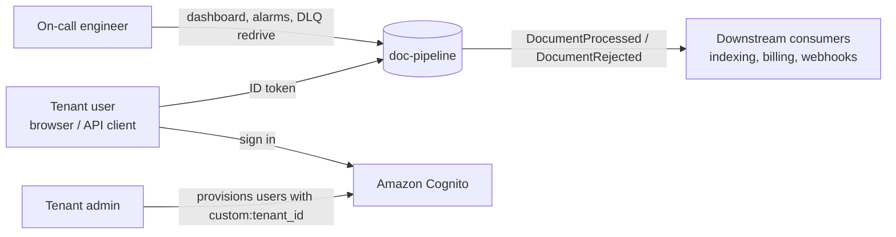
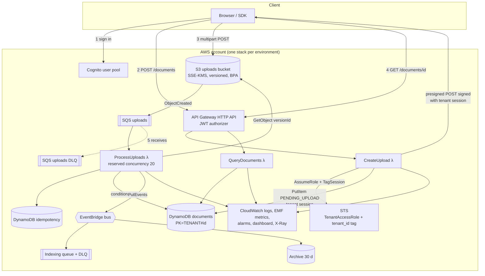
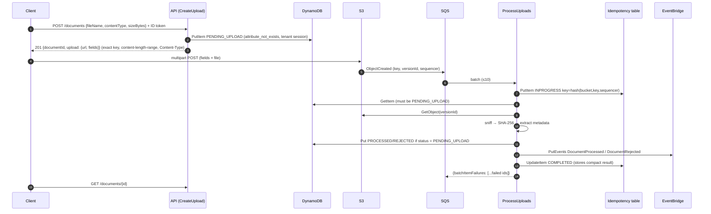

# Architecture

## Context (C4 level 1)

## Containers (C4 level 2)

## Code layout (hexagonal)

| Layer | Path | Depends on | Notes |
|---|---|---|---|
| Domain | `src/domain` | nothing | Document lifecycle, tenant/document ids, object-key layout, upload policy. ESLint forbids AWS imports. |
| Application | `src/application` | domain | Use cases (`RequestUpload`, `ProcessDocument`, `QueryDocuments`), ports, content inspection, event contract. |
| Adapters | `src/adapters` | application, AWS SDK, parsers | DynamoDB repository, S3 signer/object store, EventBridge publisher, STS tenant sessions, CSV/JSON/PDF extractors. |
| Handlers | `src/handlers` | everything | Lambda entry points: parse event → use case → response. Composition at module scope. |
| Infra | `src/infra` | AWS SDK, Powertools | Env parsing, client factories (X-Ray instrumented), tenant client pool, observability wrapper. |

## Upload and processing sequence

## Data model (documents table)

| Attribute | Example | Notes |
|---|---|---|
| `PK` | `TENANT#acme` | Partition = tenant; IAM `LeadingKeys` pins sessions to it |
| `SK` | `DOC#01a2093c-6894-74bd-…` | UUIDv7: sort order = creation order, so listing needs no GSI |
| `status` | `PENDING_UPLOAD` / `PROCESSED` / `REJECTED` | Transitions are conditional Puts |
| `objectKey`, `versionId` | `tenants/acme/documents/<id>`, `M2Ia…` | Version pinned at processing time |
| `sizeBytes`, `sha256`, `metadata` | `{"kind":"csv","rowCount":3,…}` | Metadata is a tagged union per content type |
| `expiresAt` | epoch s | TTL only while pending (7 days); removed on transition |

## Event contract

`source = doc-pipeline.documents`, `detail-type ∈ {DocumentProcessed, DocumentRejected}`, `detail.schemaVersion = 1`, `detail.eventId = <documentId>:<status>` for consumer de-duplication. Types: [`src/application/events.ts`](../src/application/events.ts). Breaking changes get a new detail-type.

## Limits and quotas to watch

| Limit | Value here | Why |
|---|---|---|
| Max upload | 10 MiB (`MaxUploadBytes`) | Enforced by S3 (policy) and again by the processor |
| Presigned POST TTL | 5 min | Bounded also by the tenant session lifetime |
| Processor reserved concurrency / ESM max concurrency | 20 / 18 | Caps DynamoDB/S3 pressure; ESM below reserved avoids throttles |
| API reserved concurrency | 50 each | Protects the account pool; throttles are alarmed |
| HTTP API stage throttling | 100 rps, burst 200 | Coarse; per-tenant quotas are a known gap (threat model) |
